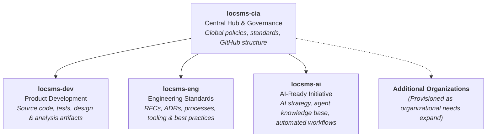

# LOC Software — Central Governance & Organization Hub

Welcome to the central GitHub organization for **LOC Software** (`locsms-cia`).

This organization serves as the umbrella and single source of truth for company-wide GitHub standards, structural governance, global engineering policies, and architectural strategies across all LOC Software GitHub organizations.

---

## 🏛️ Ecosystem Overview

To maintain clarity, security, and scalable autonomy across engineering teams, LOC Software organizes its GitHub assets across specialized secondary organizations coordinated by this central hub.

### Organizations Directory

| Organization | Scope & Purpose | Primary Audience | Key Artifacts |
| :--- | :--- | :--- | :--- |
| **`locsms-cia`** | **Central Governance & Strategy** Defines cross-organization rules, GitHub structure, and global policies. | All teams, architects, and engineering leadership | Global policies, org blueprints, shared workflow templates |
| **[`locsms-dev`](https://github.com/locsms-dev)** | **Product Development & Delivery** Central repository hub for software products, services, libraries, and applications. | Software engineers, QA, DevOps | Source code, unit/integration tests, design & analysis documents, CI/CD pipelines |
| **[`locsms-eng`](https://github.com/locsms-eng)** | **Engineering Standards & Definitions** The focal point for engineering practices, technical decision-making, and methodology definitions. | Staff engineers, architects, developers | RFCs (Requests for Comments), ADRs, process guidelines, quality & security benchmarks |
| **[`locsms-ai`](https://github.com/locsms-ai)** | **AI-Ready Project & Knowledge Base** Drives LOC Software's AI-readiness strategy, building structured knowledge bases and agent-accessible operational models. | AI engineers, domain specialists, autonomous agents | AI strategy documents, agent design artifacts, knowledge-base schemas, agent RFCs |

> [!NOTE]
> Additional secondary organizations may be provisioned as LOC Software's product lines and operational requirements scale. All new organizations must conform to the governance models established here in `locsms-cia`.

---

## 🧭 Core Principles

### 1. Documentation as Code (Docs-as-Code)
We actively foster a **Documentation as Code** culture across LOC Software:
- **Version Controlled:** All documentation, architecture blueprints, RFCs, and guidelines live in Git repositories alongside or paired with code.
- **Peer-Reviewed:** Changes to documentation go through standard Pull Request (PR) workflows, code reviews, and discussions.
- **Future-Proof Knowledge Base:** Structured, unambiguous documentation serves as an evergreen institutional memory for human teams and AI agents alike.

### 2. Single Source of Truth
Global conventions—including repository naming guidelines, branch protection rules, tagging standards, and security baselines—are maintained centrally within `locsms-cia` to eliminate drift across secondary organizations.

### 3. AI-Ready Architecture
Through the **AI Ready** initiative (`locsms-ai`), our engineering documents and design artifacts are structured to empower AI agents to assist in developing, testing, and maintaining LOC Software products reliably.

---

## 🔐 Access Management

Access across LOC Software organizations follows the principle of least privilege while encouraging transparent cross-team collaboration:

- **Need-Based Contributor Access:** Write and administrative permissions are granted based on team assignments and project responsibilities.
- **Knowledge Sharing:** Read access is made widely available to team members who rely on repositories as sources of technical information or architectural reference.
- **Onboarding:** Developers joining LOC Software typically onboard through `locsms-dev` for day-to-day code contributions and `locsms-eng` / `locsms-cia` for reference documentation and process standards.

---

## 📂 What Belongs in `locsms-cia`?

Repositories in this organization are strictly reserved for cross-cutting, company-wide concerns:
- **Global Governance Policies:** Defining organizational structures, membership rules, and GitHub team models.
- **Standards & Templates:** Organization-wide templates (Issue/PR templates, CI/CD reusable workflows, `.github` profiles).
- **Compliance & Security Baselines:** Organization-level audit configurations, license policies, and security guardrails.

---

## 🤝 Contributing & Proposing Changes

1. **RFC Process:** Substantial policy or structural proposals should start as an RFC in `locsms-eng` or an issue within the relevant governance repository in `locsms-cia`.
2. **Pull Requests:** Submit changes via branches and PRs. Ensure all Markdown adheres to standard formatting and passes repository linting checks.
3. **Review & Approval:** Changes to global policies require review from designated engineering leads and organization administrators.

---

*Managed by LOC Software Engineering & Architecture Team.*
